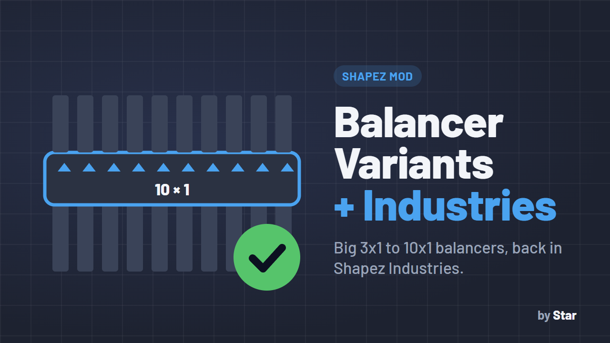

# BalancerVariants - Industries Compat

**Lets you use the big balancers from Balancer Variants while playing Shapez Industries.**

## Why you need it

[Balancer Variants](https://mod.io/g/shapez/m/balancervariants) adds large balancers (3x1 up to 8x1, or 10x1 with [my modified version](https://github.com/Star69995/shapez-balancer-variants)) that merge, split and balance many belts with a single building - much smaller and cleaner than chaining 2x1 balancers.

But when [Shapez Industries](https://shapez.mod.io/shapez-industries) is also installed, Industries takes over the balancer building, and the extra balancers simply **disappear from the toolbar** (or break when placed). This tiny mod fixes that: with both mods installed, the big balancers are back and work normally, alongside Industries' own balancers.

No settings, nothing to click - just install it next to the other two mods.

## How to use

1. Install **Balancer Variants**, **Shapez Industries** and this mod (all three `.js` files in your `mods` folder).
2. Start or load a Shapez Industries game.
3. Select the **Balancer** in the toolbar and press **T** (cycle variants) to reach the 3x1 ... 10x1 balancers - they appear next to Industries' own balancer variants.
4. Place them like any balancer: belts go in on one side and come out balanced on the other.

## How it works

It waits until all mods are loaded, then adds the Balancer Variants variants back to the balancer's list and sends them to Balancer Variants' own setup code, while leaving every Industries variant to Industries.

## Requirements

- [Balancer Variants](https://mod.io/g/shapez/m/balancervariants) (or [my modified version](https://github.com/Star69995/shapez-balancer-variants))
- [Shapez Industries](https://shapez.mod.io/shapez-industries)

Keep the file name as is: the game loads mods alphabetically and this file must load after `BalancerVariants.js`.

## Installation

Download the `.js` file, put it in your shapez.io `mods` folder (on Windows: `%APPDATA%\shapez.io\mods`) and restart the game.

## Author

Made by **Star** ([Star69995](https://github.com/Star69995)). MIT License - see [LICENSE](../LICENSE).
