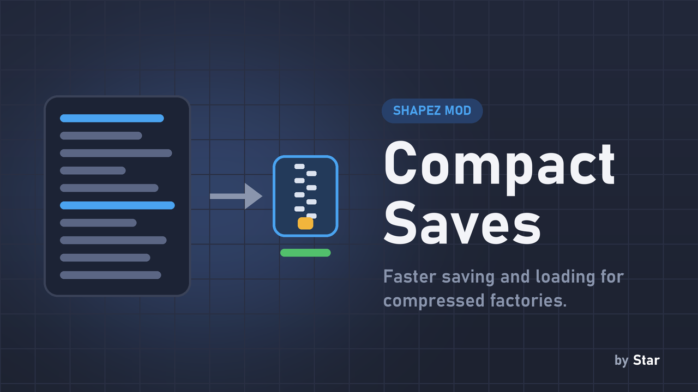

# Compact Saves

**Faster saving and loading for games with many compressed factories.**

This is an add-on: it needs the [Factory Compressor](../factory-compressor/) mod.

## Why you want it

Every compressed factory keeps the buildings of the original factory inside the savegame, written as text. With hundreds of compressed factories that is a lot of text, and saving and loading get slow. Compact Saves writes the buildings inside each factory **compressed** instead, which makes saving and loading much faster.

## What you need to know

- Nothing to set up: install it next to Factory Compressor and save as usual. Small factories that would not gain anything are left as they are.
- **Your saves stay readable without this mod:** Factory Compressor itself can read compact saves, so you can remove Compact Saves at any time. (When you save again without it, the factories are written the normal way.)

## Compatibility

- shapez 1.5.0 or newer.
- Requires Factory Compressor.

## Installation

Download `compact_saves.js`, put it in your shapez.io `mods` folder (on Windows: `%APPDATA%\shapez.io\mods`) and restart the game.

mod.io: https://mod.io/g/shapez/m/compact-saves
