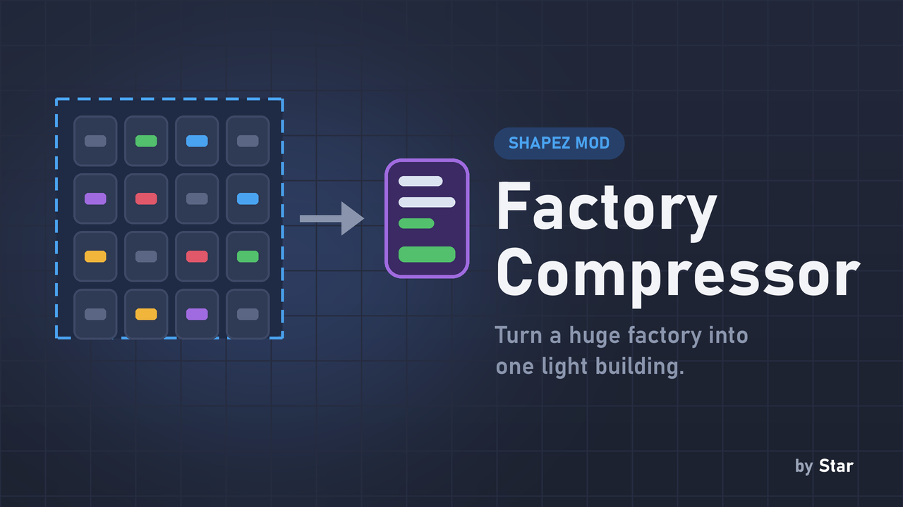

# Factory Compressor

**Turn a huge factory into one building, so the game no longer simulates every belt and machine in it.**

> **Experimental - back up your saves before using it.** Compressed factories are stored in the savegame, so they are lost if you remove the mod (you can unpack them first).

## Why you want it

A big factory with thousands of belts and machines makes the game slow, even when most of it just keeps running the same way. Factory Compressor replaces a finished factory with a single box that runs a **light model** of it: the box takes the shapes that really arrive, and puts out what the factory would, at your current upgrade speeds. The game only has to think about one building instead of thousands.

## How to use

- Select the factory with **Ctrl+drag**, then press **K** (or the button in the panel at the bottom).
- The factory becomes a **Compressed factory** box. Click it to give it a name, see its recipe, or **unpack** the original factory (select several boxes with Ctrl+drag to unpack them all at once). Unpacking is free.
- Copy and paste a box like any building.

## What the box shows

- Its name, and **what it takes in and puts out per second** (IN / OUT rows).
- Whether it runs at **full capacity**, at N%, **needs more of a shape**, or its **output is blocked**. A shape it should handle but gets none of shows 0/s in red.
- Zoomed out, small boxes show a square in their status color and bigger ones show a label with the name and main products.

## How it works

- The box runs a model of its buildings once per second: every machine uses the game's own shape operations at the current upgrade speed, balancers split, belts back up. Upgrades apply immediately.
- Inputs are the shapes that really arrive (belts, teleporters, miners inside); outputs go to real belts, teleporters and the Hub.
- A model where nothing moves goes to sleep until something arrives or leaves, so it costs almost nothing.
- Areas with a building the model does not know are measured for 60 seconds instead, and run a fixed recipe.
- Machines from other mods that register a normal item processor (for example Shapez Expanded) and balancer variants (for example Balancer Variants) work too.

## What is never compressed

Anything that depends on the outside stays a real building at the edge of the box: **Hub Extractors, teleporters and Micro Hubs**. Put them at the factory's edge, not inside it. The mod refuses areas with logic gates, belt readers, wire networks or tunnels that leave the area, and unbought chunks.

## Cost

Compressing costs blueprint shapes, like pasting the area. Deleting a box refunds the buildings inside (with the Building Costs mod, each building's own price too).

## Compatibility

- shapez 1.5.0 or newer.
- [Compact Saves](../compact-saves/) (optional): makes saving and loading with many boxes much faster. Factory Compressor can read those saves by itself.
- **Building Costs** (optional): a box then costs what the buildings inside would cost.

## Installation

Download `factory_compressor.js`, put it in your shapez.io `mods` folder (on Windows: `%APPDATA%\shapez.io\mods`) and restart the game.

mod.io: https://mod.io/g/shapez/m/factory-compressor
