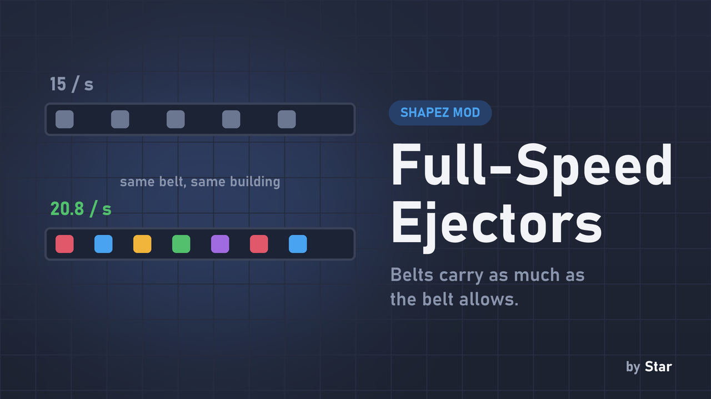
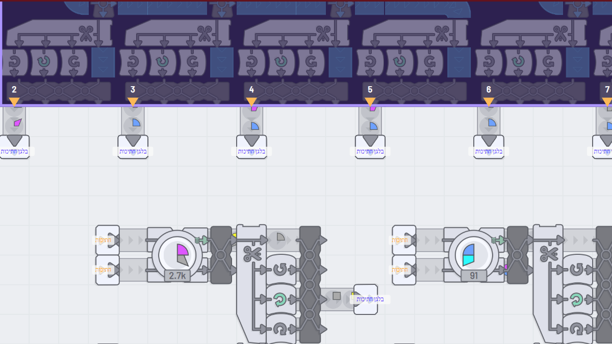
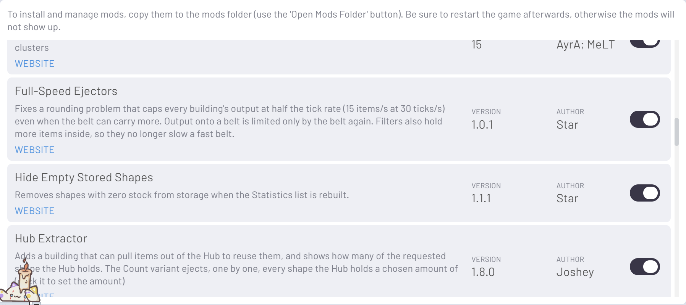

# Full-Speed Ejectors

**Buildings (storage, machines, extractors, readers) pass items on as fast as the next belt or building allows, even at a low tick rate.**

## The problem

When the game runs at 30 ticks per second, every building's output onto a belt is capped at **15 items/s**, even with belts that could carry 20.8. The cause is rounding: an item is handed to the belt only once its internal progress reaches 1, progress grows a little less than 1 per tick, and the leftover is thrown away - so each item takes 2 ticks. At 60 ticks/s the same effect caps output at 20/s, which is why most players never notice.

## What this mod does

Items are offered to the next belt or building right away. The target still enforces its own limits (belt spacing, a machine's free input), so the limit becomes the real one (checked with a simulation: 30 ticks/s goes from 15.0 to 20.8 items/s on a belt; 60 ticks/s from 20.0 to 20.8). This also covers building-to-building hand-offs, for example a belt reader placed right next to a hub, a trash or a producer, which used to stay at 15/s even when a reader in the middle of a belt gave 20.4. Outputs with nothing connected are unchanged.

**Filters** hold 4 items inside instead of 2, so they no longer refuse items now and then and slow a fast belt.

It adds one small check to the moment an item is ejected and nothing per tick, so it has no measurable performance cost.

## Notes

- Output of your factory goes up at low tick rates, so production numbers will change. That is the point, but save a backup first if your factory is balanced around the old limit.
- Does not touch savegames; remove the file to go back to the old behaviour.
- No other mods needed. Mods that compute their own throughput (for example a compressed factory) may still show their own numbers.

## Screenshots

mod.io: https://mod.io/g/shapez/m/full-speed-ejectors
