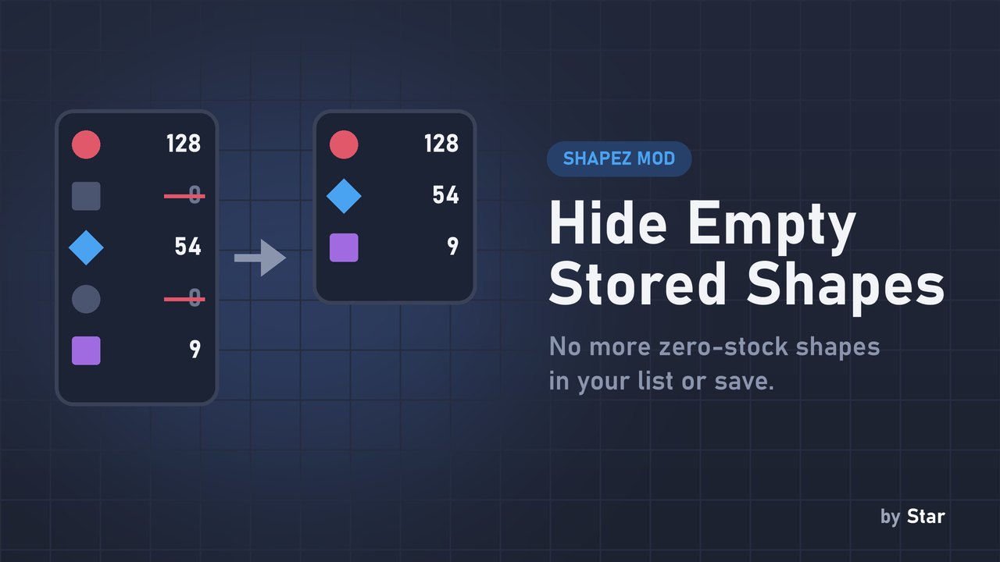
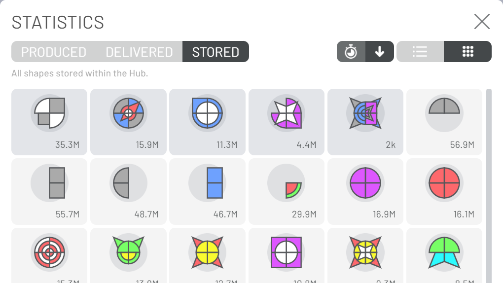
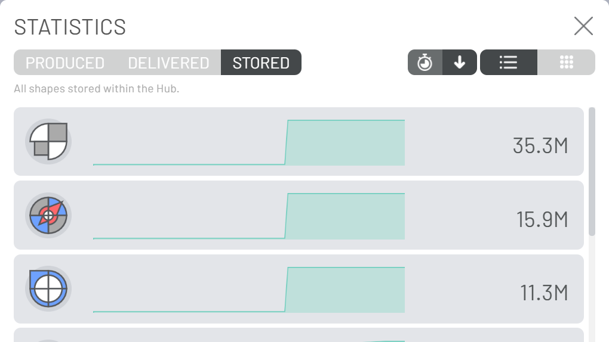

# Hide Empty Stored Shapes

**Keeps the Statistics list and your savegame free of shapes you no longer have.**

## Why you want it

Once the Hub has stored a shape, the game never forgets it: even at zero stock it stays in the Statistics list and in the savegame forever. After a long game with many shapes that means a long list full of zeros, a bigger save, and more work for every part of the game (and other mods) that walks over the stored shapes.

## What it does

Each time the Statistics list is rebuilt, shapes with zero stock are removed from the Hub's storage. A shape that is missing reads as 0 everywhere in the game, so nothing changes except that the list and the save stay short. If you store the shape again, it comes back.

## Compatibility

- shapez 1.5.0 or newer. No other mods needed.
- Safe to add or remove at any time.

## Installation

Download `hide_empty_stored_shapes.js`, put it in your shapez.io `mods` folder (on Windows: `%APPDATA%\shapez.io\mods`) and restart the game.

## Screenshots

mod.io: https://mod.io/g/shapez/m/hide-empty-stored-shapes
