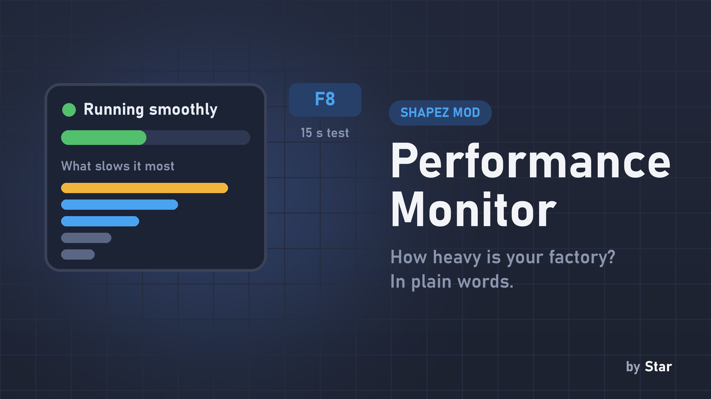

# Performance Monitor

**Find out how heavy your factory is for the game, how many more buildings it can take, and what slows it down - in plain words.**

## Why you want it

Big factories lag, and the game gives you no way to tell why. Performance Monitor adds a small panel in the **bottom-right corner** (it never intercepts mouse clicks) and a 15 second test. It speaks **English or Hebrew** to match your game language.

## The live panel

- **A status line and a bar:** green "Running smoothly", yellow "The factory is getting heavy", red "Too heavy - the game is slowing down". The bar is how much of the game's time budget your factory uses.
- **Buildings:** how many you have, a **comfortable limit** (an estimate, shown as a range because it depends on your mix of buildings - tunnels and filters cost more than plain belts), and whether you have room, are close to it, or are over it.
- **Game speed:** ticks per second against the target, and frames per second.

It costs two timer reads per tick and per frame and refreshes once a second, so it does not slow the game down.

## The test (F8)

Press **F8**: for 15 seconds every part of the game is timed, then the timers are removed. You get a table of **what slows your factory the most**: its share of the load, how many buildings it has, and "weight each" (x2 = twice as heavy as an average building). The game runs a little slower during the test, which is why it is not always on.

| Key | Action |
|---|---|
| F7 | Show / hide the panel |
| F8 | Run the 15 second test |
| F9 | Show technical details (milliseconds per tick, microseconds per building) |

All keys can be rebound in the keybindings settings. The test result is also printed to the developer console.

## Compatibility

- shapez 1.5.0 or newer; no other mods needed. Does not touch savegames, safe to add or remove at any time.
- Costs are per *system*, not per building type (for example all cutters, painters and mixers share the "Machines" system). Systems added by other mods show under their internal name.

mod.io: https://mod.io/g/shapez/m/performance-monitor
