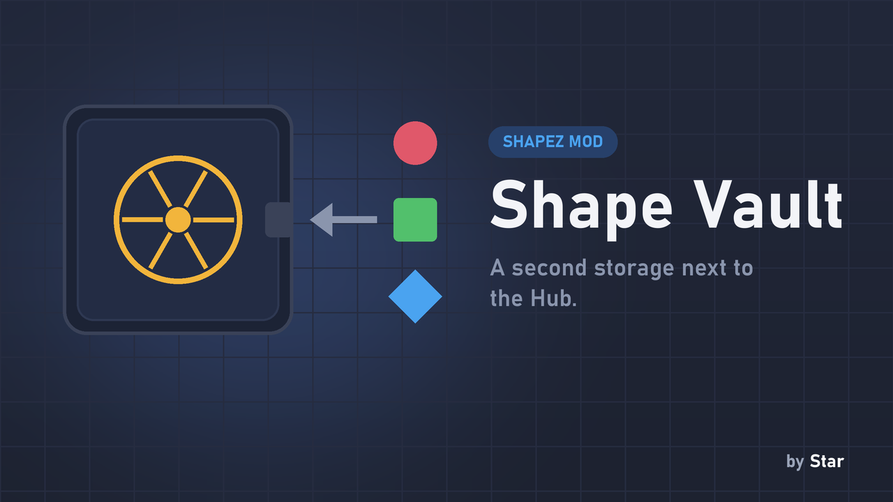
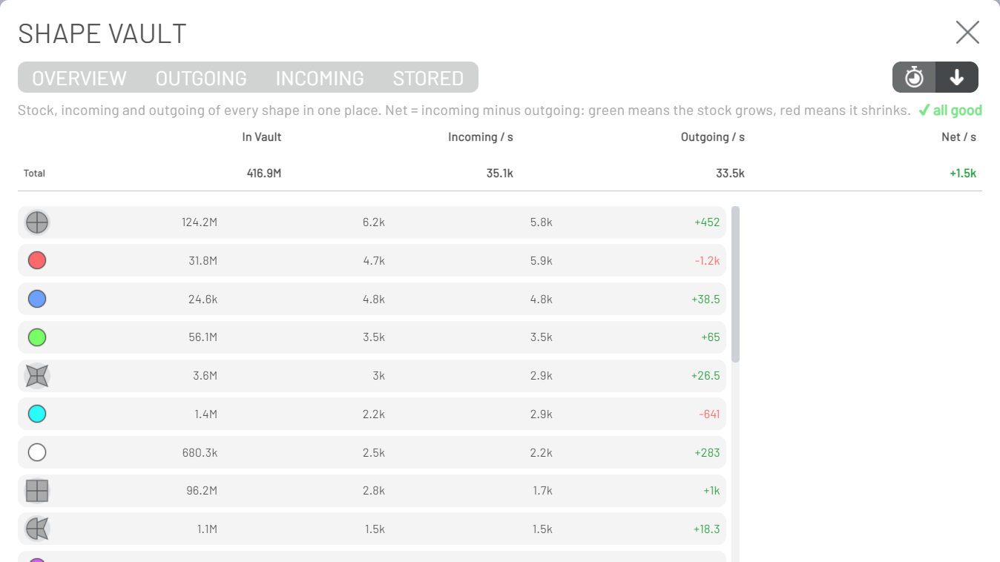
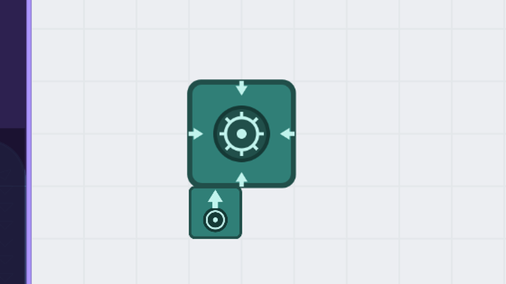

# Shape Vault

**A second storage next to the Hub, for shapes you want to keep but not count towards your goals.**

## Why you want it

Everything you send to the Hub is both your stock *and* what the goals and upgrades spend. If you want a reserve of shapes for building, for blueprints or for a later project, they get mixed up with it. The **Vault** keeps them apart: it takes shapes from belts and stores them separately, and only gives them back when you ask. It costs almost nothing per tick and adds only a few lines to the save.

## Buildings

| Building | What it does |
|---|---|
| Shape Vault (2x2 and 1x1) | Stores the shapes you feed it, apart from the Hub. |
| Vault Extractor | Send it a shape on the wires layer and it ejects that shape. |
| Shape Extractor | Ejects the shape whose code you type (click it to set), for as long as the Vault holds it. No wires needed. |
| Overflow Extractor | Ejects everything above an amount you set, keeping that amount of each shape. No wires needed. |
| Vault Sensor | Wires layer. With a shape on the pin: 1 if the Vault holds more than the amount you set, else 0. With nothing connected: reports the stock. |

## Statistics window (F6)

Press **F6** (or click the Vault button) for an overview of every shape: how many are **stored**, **incoming** and **outgoing**, and the **net** change (green = the stock grows, red = it shrinks). Shapes that something asked for but the Vault ran out of are marked in red. Click a shape to copy its code.

## Arrival indicator

A small indicator tells you whether what you take out of the Vault keeps arriving, so you notice when a shape runs short.

## Compatibility

- shapez 1.5.0 or newer. English and Hebrew.
- **Building Costs** (optional): building costs can then be paid from the Vault, after the Hub and unlimited Custom Storages.
- The Vault is saved inside your savegame. Take the shapes out before you remove the mod.

## Installation

Download `shape_vault.js`, put it in your shapez.io `mods` folder (on Windows: `%APPDATA%\shapez.io\mods`) and restart the game.

## Screenshots

mod.io: https://mod.io/g/shapez/m/shape-vault
