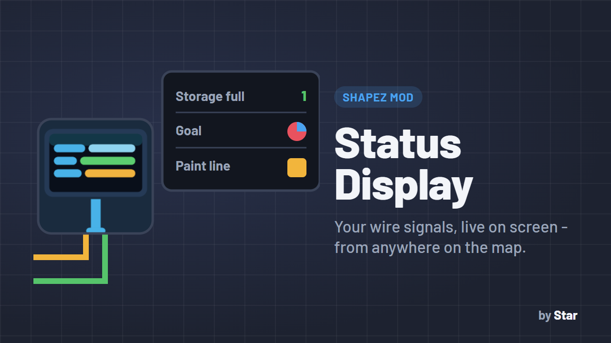
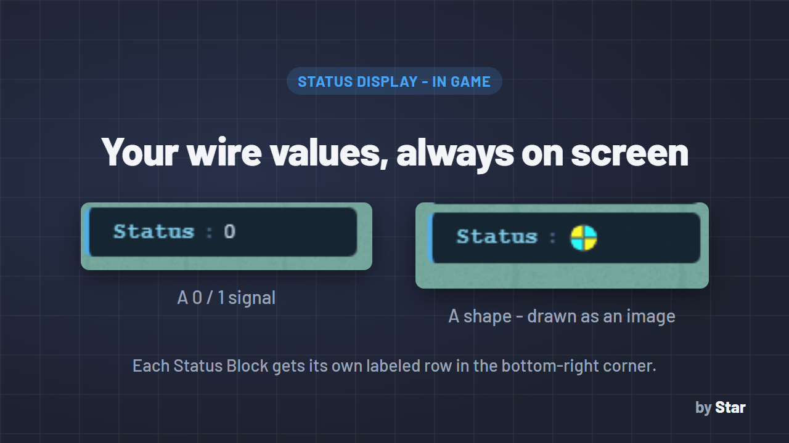

# Status Display



**A live dashboard for your factory: see the wire values you care about on screen, from anywhere on the map.**

## Why you want it

In shapez, a wire signal - is the storage full, which shape is the Hub asking for, is a machine running - can only be seen by flying over to it and switching to the wires layer. In a big factory you keep flying back and forth just to check.

Status Display adds a **Status Block**: connect any wire to it, give it a name, and its value appears in a small panel in the **bottom-right corner of the screen**, all the time, wherever you are:

```
Main storage full : 1
Current goal      : [shape]
Paint line        : red
```

- Watch **storage-full signals** to know when a line is backing up.
- Show the **shape the Hub is asking for** (e.g. from the goal-shape wire output of [Micro Hub](https://github.com/Star69995/Shapez.io-Mods)) or the shape a production line is making.
- Monitor **colors, shapes and 0/1** values - shapes are drawn as small images, not just codes.
- Add as many blocks as you want; each gets its own labeled row, and rows disappear when the block is removed.



## What it can show

| Wire value | Shown as |
|---|---|
| Shape | A small image of the shape |
| Boolean (0 / 1) | `0` or `1` |
| Color | The color's name (`red`, `green`, ...) |
| Number (from mods with number signals) | The number |
| No signal | `---` |
| Anything else | `?` |

## Compatibility

- **Game version:** shapez 1.5.0 or newer (the modding update).
- **No other mods needed.** Works with any mod that puts values on wires, e.g. the goal-shape output of [Micro Hub](https://github.com/Star69995/Shapez.io-Mods).
- The Status Block is a building saved in your savegame.

## How to use

1. On the **wires layer**, place a **Status Block** (wires toolbar).
2. Type a label when asked (you can change it later by clicking the block).
3. Connect a wire to the block's **bottom pin**.
4. The label and live value show up in the bottom-right panel.

## Installation

Download the `.js` file, put it in your shapez.io `mods` folder (on Windows: `%APPDATA%\shapez.io\mods`) and restart the game.

## Author

Made by **Star** ([Star69995](https://github.com/Star69995)). MIT License - see [LICENSE](../LICENSE).
